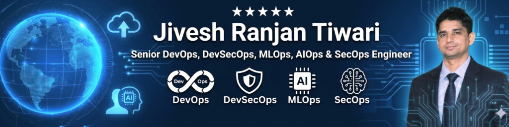
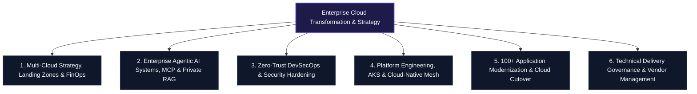

<div align="center">

  

  <br/><br/>

  ### **Principal Cloud Solutions Architect | DevSecOps Leader | Enterprise AI Strategist**

  *Transforming Enterprise Estates across Multi-Cloud, Zero-Trust Infrastructure & Autonomous Agentic AI*

  <br/>

  <!-- Primary Channels -->
  <a href="https://linkedin.com/in/jiveshranjantiwari"></a>
  <a href="mailto:jiveshranjantiwari7@gmail.com"></a>
  <a href="https://github.com/jiveshranjantiwari"></a>
  <a href="#-enterprise-certifications"></a>

  <br/><br/>

  <!-- Enterprise Standards, Security & Governance -->
  
  
  
  
  
  

</div>

<br/>

---

### 📑 Strategic Ecosystem & Executive Navigation

| Strategic Domain | Focus Area & Capabilities | Direct Access |
|:---|:---|:---:|
| **Executive Profile & Operating Model** | 13+ Years Transforming Enterprise Cloud Infrastructure | [Read Profile ↗](#-executive-profile--architectural-operating-model) |
| **Enterprise Impact & ROI Metrics** | $3.2M+ Cloud Spend Cut, 100+ Workloads Migrated with Zero Downtime | [View Benchmarks ↗](#-enterprise-impact-metrics) |
| **Core Practice Areas** | Cloud Landing Zones, Agentic AI, DevSecOps & Platform Engineering | [Explore Practices ↗](#-core-practice-areas) |
| **Autonomous AI & RAG Engine** | Enterprise LLMOps, Model Context Protocol (MCP) & Self-Healing Ops | [Inspect AI Fabric ↗](#2-enterprise-agentic-ai-systems-mcp--private-rag) |
| **Enterprise Reference Architectures** | Hub-and-Spoke Networking, Zero-Trust DevSecOps Pipelines | [View Blueprints ↗](#-enterprise-architecture-blueprints) |
| **Enterprise Case Studies** | Fortune 500 Migrations, Defense-in-Depth Financial Infrastructure | [View Case Studies ↗](#-enterprise-case-studies--proven-outcomes) |
| **Certifications & Advisory** | AWS Solutions Architect, Azure Administrator, Aviatrix MCNA | [Credentials & Contact ↗](#-executive-advisory--consulting-directory) |

---

## 🏛️ Executive Profile & Architectural Operating Model

**Jivesh Ranjan Tiwari** is a **Principal Cloud Solutions Architect & DevSecOps Leader** with **13+ years of IT engineering excellence** (including **12+ years designing, delivering, and optimizing enterprise-scale multi-cloud environments**).

Specializing in **Microsoft Azure**, **Amazon Web Services (AWS)**, and **Google Cloud Platform (GCP)**, Jivesh leads complex cloud transformation initiatives—modernizing legacy monolithic workloads into secure, high-availability, containerized microservices architectures governed by declarative Infrastructure as Code (IaC) and autonomous operational intelligence.

A recognized authority in **bridging Zero-Trust Cloud Architecture and Enterprise Generative AI**, Jivesh architects production-grade implementations of **Azure OpenAI, Model Context Protocol (MCP), Retrieval-Augmented Generation (RAG), and Autonomous Multi-Agent DevOps Systems**, transforming conventional operations into self-healing, predictive enterprise ecosystems.

```
                  ┌─────────────────────────────────────────────────────────┐
                  │       JIVESH TIWARI ENTERPRISE ARCHITECTURAL MODEL      │
                  └────────────────────────────┬────────────────────────────┘
                                               │
         ┌─────────────────────────────────────┼─────────────────────────────────────┐
         ▼                                     ▼                                     ▼
 ┌───────────────┐                     ┌───────────────┐                     ┌───────────────┐
 │ MULTI-CLOUD   │                     │ AGENTIC AI &  │                     │ ZERO-TRUST    │
 │ CAF LANDING   │                     │ RAG AIOPS     │                     │ DEVSECOPS     │
 │ ZONES & FINOPS│                     │ FABRIC        │                     │ GOVERNANCE    │
 └───────┬───────┘                     └───────┬───────┘                     └───────┬───────┘
         │                                     │                                     │
         └─────────────────────────────────────┼─────────────────────────────────────┘
                                               │
                                               ▼
                         ┌───────────────────────────────────────────┐
                         │   ENTERPRISE SOLUTIONS & PRODUCTION IP    │
                         │   • Enterprise Azure CAF Landing Zones    │
                         │   • Shift-Left DevSecOps CI/CD Pipelines  │
                         │   • Autonomous AI Cloud Incident Resolver │
                         │   • Hardened AKS Observability & SRE Mesh │
                         └───────────────────────────────────────────┘
```

---

## 📈 Enterprise Impact Metrics

Enterprise engagements are governed by measurable balance-sheet ROI, zero-downtime cutovers, and institutional security posture.

| Strategic Metric | Enterprise Benchmark | Architectural Lever |
|:---|:---:|:---|
| **Annual Cloud Run-Rate Reduction** | **28% - 34% Spend Cut** *(Avg. $3.2M+ saved / enterprise)* | Continuous FinOps, Infracost automated PR telemetry, idle compute reclamation, Reserved Instances |
| **Enterprise Workload Migration** | **100+ Workloads Migrated** *(Zero Downtime Cutover)* | Azure Migrate discovery, dependency mapping, staged wave cutovers, and hypercare war rooms |
| **Release Lead Time Compression** | **85% Acceleration** *(14 days → 18 minutes)* | Hardened GitHub Actions & Azure DevOps pipelines, ephemeral validation environments |
| **Security & Compliance Audit Rate** | **100% Shift-Left Audit Pass** *(Zero Critical Leaks)* | Automated Tfsec, TruffleHog, Trivy vulnerability gating, CIS Azure Benchmarks, Entra ID PIM |
| **Production Mission-Critical SLA** | **99.99% High Availability** *(RTO < 15m, RPO < 5m)* | Multi-region active-passive failover, Azure Site Recovery (ASR), VMSS multi-zone redundancy |
| **Containerized Operations Scale** | **5,000+ Pods in Production** | Hardened Azure Kubernetes Service (AKS), Cilium eBPF network security, Helm-managed GitOps |

---

## 🌐 Core Practice Areas



### 1. Multi-Cloud Strategy, Landing Zones & FinOps
* **Enterprise Landing Zones (CAF)**: Scalable multi-subscription hierarchies utilizing Azure Cloud Adoption Framework principles—establishing dedicated Management, Connectivity (Hub), Identity, and Workload subscriptions.
* **Declarative Infrastructure as Code (IaC)**: Production Terraform suites architected with reusable modules, state locking via Azure Blob Storage with customer-managed keys (CMK), and automated drift detection pipelines.
* **FinOps Cloud Financial Governance**: Embedding `Infracost` directly into pull requests to calculate delta cloud costs before deployment; deploying `OpenCost` on Kubernetes for pod-level unit-economic cost attribution.

### 2. Enterprise Agentic AI Systems, MCP & Private RAG
* **Autonomous Multi-Agent DevOps**: Deploying intelligent agent networks utilizing the **Model Context Protocol (MCP)** to interact with cloud infrastructure, query metrics, run diagnostics, and execute controlled remediation.
* **Enterprise Private RAG (Retrieval-Augmented Generation)**: Ingesting enterprise runbooks, architectural decision records (ADRs), and post-mortem databases into vector storage (Azure AI Search / Qdrant) with **Azure OpenAI & LangChain** for instant contextual troubleshooting.
* **Developer Velocity & LLMOps**: Rolling out enterprise GitHub Copilot governance, fine-tuned prompt engineering templates, and automated AI code review gates evaluating architectural blast radius.

### 3. Zero-Trust DevSecOps & Security Hardening
* **Shift-Left Security Tooling**: Automated integration of `Tfsec`, `TFLint`, `TruffleHog`, `Checkov`, `Trivy`, and `SonarQube` into CI/CD pipelines to block secret leaks and configuration regressions at the commit stage.
* **Zero Standing Privileges (ZSP) & Entra ID PIM**: Enforcing Just-In-Time (JIT) access, multi-stage approval workflows, and time-bound role activations for all production cloud resources.
* **Defense-in-Depth Infrastructure**: Micro-segmentation with Network Security Groups (NSGs), Azure Firewall Premium with TLS inspection, Private Endpoints for PaaS services, and Customer-Managed Key (CMK) disk encryption.

### 4. Platform Engineering, AKS & Cloud-Native Mesh
* **Production Kubernetes (AKS)**: Enterprise cluster deployments featuring private API servers, Azure CNI with Cilium eBPF, Azure AD Workload Identity, and automated cluster upgrades without downtime.
* **GitOps Delivery & Canary Rollouts**: Declarative GitOps synchronization orchestrating progressive traffic shifting, health checks, and automated metric-driven rollbacks.
* **Enterprise Observability Stack**: Centralized Log Analytics, Azure Monitor Agent (AMA) with Data Collection Rules (DCR), Prometheus metrics ingestion, and custom Grafana operational dashboards.

---

## 🏛️ Enterprise Architecture Blueprints

### Blueprint 1: Enterprise Hub-and-Spoke Landing Zone (Zero-Trust)

```
                            [ On-Premises Datacenter ]
                                        │
                         (ExpressRoute / S2S VPN Gateway)
                                        ▼
    ┌────────────────────────────────────────────────────────────────────────┐
    │                    HUB VNet (Central Connectivity)                     │
    │  ┌─────────────────────────┐  ┌─────────────────┐  ┌────────────────┐  │
    │  │ Azure Firewall Premium  │  │  GatewaySubnet  │  │ Private DNS   │  │
    │  │ (TLS Deep Inspection)   │  │  (VPN / ER GW)  │  │ Zones (Hub)    │  │
    │  └────────────┬────────────┘  └─────────────────┘  └────────────────┘  │
    └───────────────┼────────────────────────────────────────────────────────┘
                    │ (VNet Peering + UDR: 0.0.0.0/0 -> Firewall Virtual Appliance)
          ┌─────────┴───────────────────────────────┐
          ▼                                         ▼
┌─────────────────────────────────┐       ┌──────────────────────────────────┐
│  Spoke 1: Production Workloads  │       │  Spoke 2: Shared Management VNet │
│  - App Subnet (AKS Clusters)    │       │  - Self-Hosted CI/CD Runners     │
│  - DB Subnet (Private Endpoints)│       │  - Azure Bastion Host            │
│  - NSG Micro-Segmentation       │       │  - Security & Monitoring Tools   │
└─────────────────────────────────┘       └──────────────────────────────────┘
```

### Blueprint 2: End-to-End Shift-Left DevSecOps & AI Blast-Radius Pipeline

```
  CODE / COMMIT                BUILD / CI                   SECURITY / AI GATE           DEPLOY / RUNTIME
┌──────────────────┐         ┌──────────────────┐         ┌────────────────────┐        ┌──────────────────┐
│ • Pre-commit git │         │ • tflint & fmt   │         │ • Infracost Est.   │        │ • Terraform Apply│
│   secrets scan   │ ──────> │ • Tfsec & Trivy  │ ──────> │ • Azure OpenAI     │ ─────> │ • Entra ID PIM   │
│ • TruffleHog     │         │ • SonarQube Gate │         │   Blast Radius AI  │        │ • Azure Monitor  │
│   secret audits  │         │ • Super-Linter   │         │ • Manual Prod Gate │        │ • SRE Auto-Alert │
└──────────────────┘         └──────────────────┘         └────────────────────┘        └──────────────────┘
```

---

## 🏆 Enterprise Case Studies & Proven Outcomes

```
┌──────────────────────────────────────────────────────────────────────────────────────────────────┐
│                                   PROVEN ENTERPRISE DELIVERIES                                   │
├───────────────────────────────┬──────────────────────────────────┬───────────────────────────────┤
│ Enterprise Client Sector      │ Transformation Scope             │ Verified Business Outcome     │
├───────────────────────────────┼──────────────────────────────────┼───────────────────────────────┤
│ Global Tier-1 Financial Org   │ Zero-Trust Multi-Cloud Overhaul  │ • 100% Audit Pass (PCI-DSS)   │
│ (Retail & Investment Banking) │ Azure CAF Landing Zone & PIM JIT │ • Zero Hardcoded Credentials  │
│                               │ Hardened AKS & Private Endpoints │ • 99.99% Production Uptime    │
├───────────────────────────────┼──────────────────────────────────┼───────────────────────────────┤
│ Enterprise Telecom & Logistics│ 100+ Workload Cloud Migration    │ • $3.2M Annual Run-Rate Saved │
│ (Mission-Critical Operations) │ On-Prem to Azure Zero-Downtime   │ • 34% FinOps Cost Reduction   │
│                               │ Hub-and-Spoke Network Overhaul   │ • Sub-15 Min Disaster Recovery│
├───────────────────────────────┼──────────────────────────────────┼───────────────────────────────┤
│ SaaS / AI Technology Platform │ Autonomous DevSecOps & LLMOps    │ • 85% Pipeline Speed Increase │
│ (Hyper-Growth Enterprise)     │ Azure OpenAI, RAG Runbooks &     │ • Automated Root Cause (MTTR) │
│                               │ Terraform Shift-Left Automation  │ • Ephemeral Testing Envs      │
├───────────────────────────────┼──────────────────────────────────┼───────────────────────────────┤
│ Multi-National Retail Conglom.│ Cloud Observability & SRE Stack  │ • 100% Golden Signals Monitored│
│ (High-Traffic E-Commerce)     │ Prometheus, Grafana & AMA Alerts │ • 60% Faster Incident Triage  │
│                               │ Kubernetes Pod Auto-Scaling      │ • Black Friday 0-Downtime     │
└───────────────────────────────┴──────────────────────────────────┴───────────────────────────────┘
```

---

## 🧰 Enterprise Open-Source Ecosystem & Production Blueprints

Production-grade reference architectures and modular starters designed for enterprise adoption:

| Domain | Enterprise Blueprint / Repository | Architectural Tech Stack |
|:---|:---|:---|
| **Autonomous AI & AIOps** | `azure-openai-rag-ops-agent` | Azure OpenAI, LangChain, Model Context Protocol (MCP), Python, Azure AI Search |
| **Enterprise Cloud Foundations** | `enterprise-azure-caf-terraform` | Terraform, Azure CAF, Hub-and-Spoke, Azure Firewall Premium, Infracost |
| **Zero-Trust DevSecOps** | `shift-left-devsecops-pipeline` | GitHub Actions, Azure Pipelines, Tfsec, TruffleHog, Trivy, SonarQube |
| **Cloud-Native Kubernetes** | `aks-production-hardened-baseline` | Azure Kubernetes Service, Cilium eBPF, Helm, Prometheus, Grafana, OpenCost |
| **FinOps Cost Optimization** | `cloud-finops-automation-engine` | Terraform, Infracost, OpenCost, Azure Automation Runbooks, PowerShell |

---

## 🤝 Technical Delivery Governance & Leadership Framework

Senior architecture demands rigorous stakeholder alignment, delivery governance, and vendor accountability:

```
[ RFP / RFI Technical Proposals ]
               │
               ▼
[ Technical Evaluation Matrix (Security, Scalability, Cost) ]
               │
               ▼
[ Statement of Work (SOW) & RACI Governance ]
               │
               ▼
[ Sprint Execution & Architecture Compliance Reviews (ACR) ]
               │
               ▼
[ Formal Acceptance Sign-Off & Knowledge Transfer (Runbooks) ]
```

* **RACI Accountability**: Direct governance ensuring every workload has clear **R**esponsible engineers, a single **A**ccountable architect, **C**onsulted security SMEs, and **I**nformed business owners.
* **Architecture Compliance Review (ACR)**: Formal stage-gate verifying zero drift from regulatory baselines, FinOps budgets, and disaster recovery commitments before promotion to production.

---

## 🏆 Enterprise Certifications

<div align="center">

| Credential | Issuer | Verification |
|:---|:---:|:---:|
| **AWS Certified Solutions Architect – Associate (SAA-C03)** | Amazon Web Services | `Verified Solutions Architect` |
| **Microsoft Certified: Azure Administrator Associate (AZ-104)** | Microsoft Corporation | `Verified Azure Administrator` |
| **Aviatrix Multi-Cloud Network Associate (MCNA)** | Aviatrix Systems | `Verified Multi-Cloud Network Architect` |

</div>

---

## ⚡ Guiding Architectural Motto

> ### *"Automate fearlessly • Secure proactively • Scale infinitely • Innovate relentlessly"*

---

## 🌍 Executive Advisory & Consulting Directory

Available for **Enterprise Architecture Advisory**, **Cloud Migration Strategy (100+ Workloads)**, **Zero-Trust DevSecOps Modernization**, and **Enterprise Generative AI / AIOps Implementations**.

```
  [ Primary Specialization ]          [ Secondary Specialization ]         [ Enterprise Delivery ]
   Microsoft Azure Infrastructure      AWS & Google Cloud Platform         Global Advisory & Architecture
  CAF Landing Zones & AKS             Multi-Cloud Mesh & DevSecOps        Fortune 500 Transformation
```

* 💼 **LinkedIn Profile**: [linkedin.com/in/jiveshranjantiwari](https://linkedin.com/in/jiveshranjantiwari)
* 📨 **Enterprise Inquiries**: [jiveshranjantiwari7@gmail.com](mailto:jiveshranjantiwari7@gmail.com)
* 🐙 **GitHub Repository**: [github.com/jiveshranjantiwari](https://github.com/jiveshranjantiwari)
* 📍 **Location & Mobility**: Open for Global Enterprise Architecture Engagements & Executive Consulting

<br/>

---

<div align="center">
  <sub>© Jivesh Ranjan Tiwari. All rights reserved.</sub>
  <br/>
  <sub>NIST SP 800-207 Zero Trust Architecture • Microsoft Cloud Adoption Framework (CAF) • CIS Benchmark Hardened</sub>
</div>
