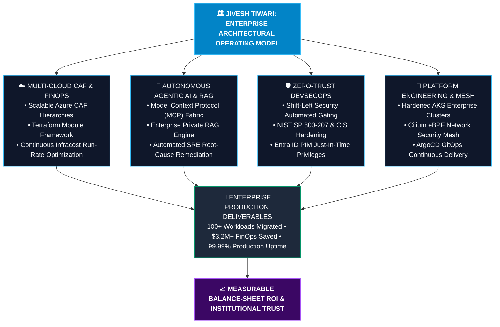
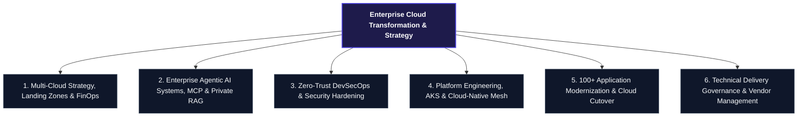
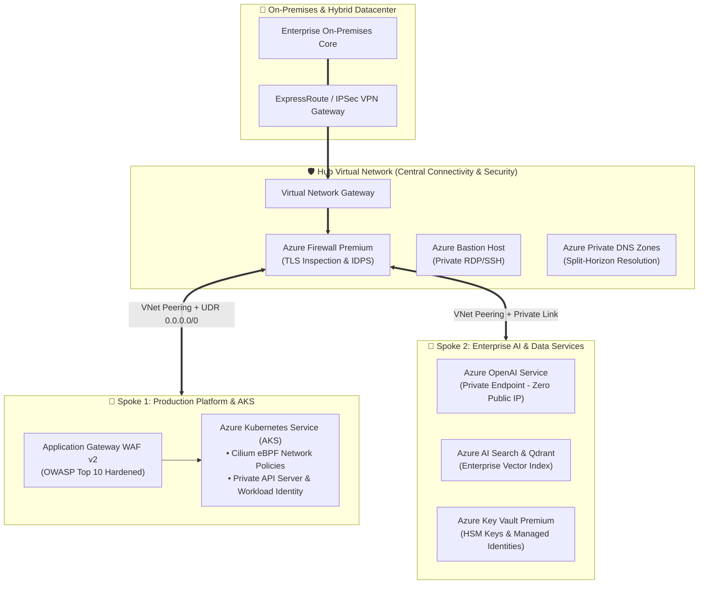
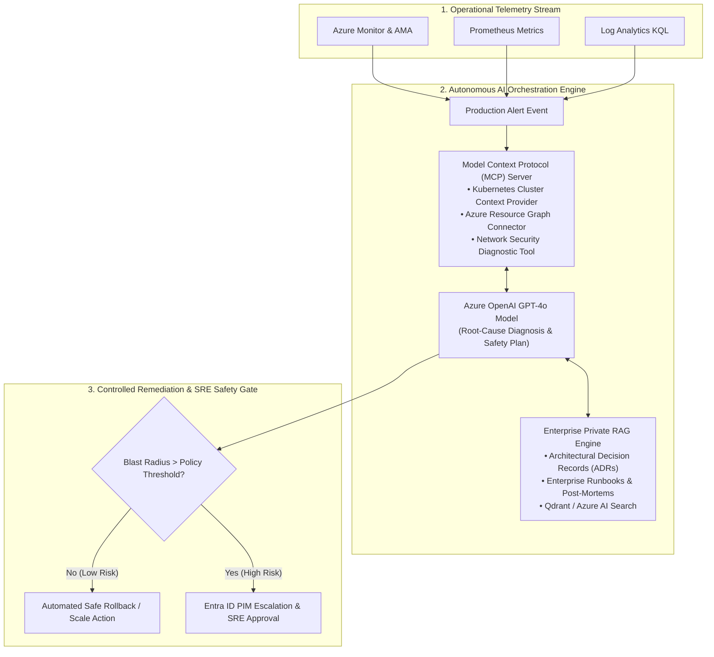
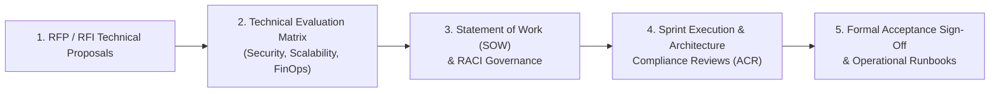

<div align="center">

  <!-- Executive Banner -->
  

  <br/><br/>

  <!-- Dynamic Typing SVG Headline -->
  <a href="https://linkedin.com/in/jiveshranjantiwari">
    
  </a>

  <p align="center">
    <strong>Architecting Zero-Trust Multi-Cloud Estates • Autonomous Agentic AIOps • High-Velocity DevSecOps</strong>
  </p>

  <!-- Executive Quick Action Badges -->
  <p align="center">
    <a href="https://linkedin.com/in/jiveshranjantiwari"></a>
    <a href="mailto:jiveshranjantiwari7@gmail.com"></a>
    <a href="https://github.com/jiveshranjantiwari"></a>
    <a href="#-enterprise-certifications"></a>
    
  </p>

  <!-- Enterprise Standards & Governance Ribbon -->
  <p align="center">
    
    
    
    
    
    
  </p>

</div>

<br/>

---

### 📑 Strategic Ecosystem & Executive Navigation

| 🧭 Strategic Domain | 🎯 Focus Area & Core Capabilities | 🔗 Direct Access |
| :--- | :--- | :---: |
| **Executive Profile & Operating Model** | 13+ Years Transforming Enterprise Multi-Cloud Infrastructure | [Read Profile ↗](#-executive-profile--architectural-operating-model) |
| **Enterprise Impact & ROI Metrics** | $3.2M+ Cloud Spend Cut, 100+ Workloads Migrated with Zero Downtime | [View Benchmarks ↗](#-enterprise-impact--roi-metrics) |
| **Live GitHub Contribution Intelligence** | Real-Time GitHub Analytics, Streak Counter & Language Distribution | [Inspect Intelligence ↗](#-dynamic-github-analytics--contribution-intelligence) |
| **Enterprise Tech Stack & Tooling Matrix** | Cloud Mesh, AKS, DevSecOps, Enterprise AI/LLMOps, FinOps & Observability | [Explore Tech Matrix ↗](#-enterprise-technology-stack--tooling-matrix) |
| **Core Practice Areas & Technical Pillars** | Cloud Landing Zones, Agentic AI, DevSecOps & Platform Engineering | [Explore Practices ↗](#-core-practice-areas) |
| **Enterprise Reference Architectures** | Hub-and-Spoke Networking, Shift-Left DevSecOps & Autonomous AI Fabric | [View Blueprints ↗](#-enterprise-architecture-blueprints) |
| **Interactive Technical Deep Dives** | Expandable Architecture Walkthroughs, IaC Blueprints & Guardrails | [Open Deep Dives ↗](#-interactive-technical-deep-dives) |
| **Enterprise Case Studies & Outcomes** | Fortune 500 Migrations, Defense-in-Depth Financial Infrastructure | [View Case Studies ↗](#-enterprise-case-studies--verified-outcomes) |
| **Flagship Open-Source Blueprints** | Production Modular Starters for CAF, DevSecOps, AKS, AI & FinOps | [Browse Blueprints ↗](#-flagship-enterprise-blueprints--open-source-ip) |
| **Certifications & Advisory Directory** | AWS Solutions Architect, Azure Administrator, Aviatrix MCNA | [Credentials & Advisory ↗](#-enterprise-certifications) |

---

## 🏛️ Executive Profile & Architectural Operating Model

**Jivesh Ranjan Tiwari** is a **Principal Cloud Solutions Architect & DevSecOps Leader** with **13+ years of IT engineering excellence**, including **12+ years designing, delivering, and optimizing mission-critical enterprise-scale multi-cloud environments**.

Specializing in **Microsoft Azure**, **Amazon Web Services (AWS)**, and **Google Cloud Platform (GCP)**, Jivesh directs complex cloud transformation programs—modernizing legacy monolithic estates into secure, resilient, containerized microservices architectures governed by declarative Infrastructure as Code (IaC) and autonomous operational intelligence.

A pioneer in **bridging Zero-Trust Cloud Architecture and Enterprise Generative AI**, Jivesh architects production implementations of **Azure OpenAI, Model Context Protocol (MCP), Retrieval-Augmented Generation (RAG), and Autonomous Multi-Agent DevOps Systems**, transforming conventional operations into self-healing, predictive enterprise ecosystems.



---

## 📈 Enterprise Impact & ROI Metrics

Enterprise engagements are governed by measurable balance-sheet ROI, zero-downtime cutovers, and institutional security posture.

<div align="center">

| 🏛️ **ENTERPRISE EXPERIENCE** | 💰 **FINOPS CLOUD SAVINGS** | 🚀 **WORKLOAD MIGRATIONS** |
| :---: | :---: | :---: |
| **13+ Years IT Excellence**<br/><sub>12+ Yrs Multi-Cloud Architecture</sub> | **$3.2M+ Annual Spend Cut**<br/><sub>28%–34% FinOps Run-Rate Reduction</sub> | **100+ Workloads Migrated**<br/><sub>Zero-Downtime Multi-Cloud Cutovers</sub> |

| 🛡️ **ZERO-TRUST GOVERNANCE** | ⚡ **DEPLOYMENT VELOCITY** | 🌐 **MISSION-CRITICAL SLA** |
| :---: | :---: | :---: |
| **100% Shift-Left Audit Pass**<br/><sub>NIST SP 800-207 & CIS Hardened</sub> | **85% Faster Release Cycle**<br/><sub>14 Days → 18 Minutes Lead Time</sub> | **99.99% Production Uptime**<br/><sub>5,000+ Pods (RTO <15m, RPO <5m)</sub> |

</div>

<br/>

| Strategic Metric | Enterprise Benchmark | Architectural Lever & Implementation Strategy |
| :--- | :---: | :--- |
| **Annual Cloud Run-Rate Reduction** | **28% – 34% Spend Cut** *(Avg. $3.2M+ saved / enterprise)* | Continuous FinOps, Infracost automated PR telemetry, idle compute reclamation, Reserved Instances & Savings Plans |
| **Enterprise Workload Migration** | **100+ Workloads Migrated** *(Zero Downtime Cutover)* | Azure Migrate discovery, dependency mapping, staged wave cutovers, and hypercare war rooms |
| **Release Lead Time Compression** | **85% Acceleration** *(14 days → 18 minutes)* | Hardened GitHub Actions & Azure DevOps pipelines, ephemeral validation environments |
| **Security & Compliance Audit Rate** | **100% Shift-Left Audit Pass** *(Zero Critical Leaks)* | Automated Tfsec, TruffleHog, Trivy vulnerability gating, CIS Azure Benchmarks, Entra ID PIM |
| **Production Mission-Critical SLA** | **99.99% High Availability** *(RTO < 15m, RPO < 5m)* | Multi-region active-passive failover, Azure Site Recovery (ASR), VMSS multi-zone redundancy |
| **Containerized Operations Scale** | **5,000+ Pods in Production** | Hardened Azure Kubernetes Service (AKS), Cilium eBPF network security, Helm-managed GitOps |

---

## 📊 Dynamic GitHub Analytics & Contribution Intelligence

<div align="center">

  <table border="0" cellspacing="0" cellpadding="0">
    <tr>
      <td align="center" valign="middle">
        <a href="https://github.com/jiveshranjantiwari">
          
        </a>
      </td>
      <td align="center" valign="middle">
        <a href="https://github.com/jiveshranjantiwari">
          
        </a>
      </td>
    </tr>
  </table>

  <br/>

  <a href="https://github.com/jiveshranjantiwari">
    
  </a>

</div>

---

## 🛠️ Enterprise Technology Stack & Tooling Matrix

<div align="center">

### ☁️ Cloud Platforms, Networking & Multi-Cloud Mesh
<p align="center">
  
  
  
  
  
  
</p>

### 🚢 Containers, Platform Engineering & Mesh
<p align="center">
  
  
  
  
  
  
  
</p>

### ⚙️ Infrastructure as Code (IaC) & Automation
<p align="center">
  
  
  
  
  
  
  
</p>

### 🔒 Zero-Trust DevSecOps & Security Hardening
<p align="center">
  
  
  
  
  
  
  
  
</p>

### 🤖 Enterprise Agentic AI, MCP & LLMOps
<p align="center">
  
  
  
  
  
  
  
</p>

### 📊 Observability, SRE & Cloud FinOps
<p align="center">
  
  
  
  
  
  
</p>

</div>

---

## 🌐 Core Practice Areas



### 1. Multi-Cloud Strategy, Landing Zones & FinOps
* **Enterprise Landing Zones (CAF)**: Scalable multi-subscription hierarchies utilizing Azure Cloud Adoption Framework principles—establishing dedicated Management, Connectivity (Hub), Identity, and Workload subscriptions.
* **Declarative Infrastructure as Code (IaC)**: Production Terraform suites architected with reusable modules, state locking via Azure Blob Storage with customer-managed keys (CMK), and automated drift detection pipelines.
* **FinOps Cloud Financial Governance**: Embedding `Infracost` directly into pull requests to calculate delta cloud costs before deployment; deploying `OpenCost` on Kubernetes for pod-level unit-economic cost attribution.

### 2. Enterprise Agentic AI Systems, MCP & Private RAG
* **Autonomous Multi-Agent DevOps**: Deploying intelligent agent networks utilizing the **Model Context Protocol (MCP)** to interact with cloud infrastructure, query metrics, run diagnostics, and execute controlled remediation.
* **Enterprise Private RAG (Retrieval-Augmented Generation)**: Ingesting enterprise runbooks, architectural decision records (ADRs), and post-mortem databases into vector storage (Azure AI Search / Qdrant) with **Azure OpenAI & LangChain** for instant contextual troubleshooting.
* **Developer Velocity & LLMOps**: Rolling out enterprise GitHub Copilot governance, fine-tuned prompt engineering templates, and automated AI code review gates evaluating architectural blast radius.

### 3. Zero-Trust DevSecOps & Security Hardening
* **Shift-Left Security Tooling**: Automated integration of `Tfsec`, `TFLint`, `TruffleHog`, `Checkov`, `Trivy`, and `SonarQube` into CI/CD pipelines to block secret leaks and configuration regressions at the commit stage.
* **Zero Standing Privileges (ZSP) & Entra ID PIM**: Enforcing Just-In-Time (JIT) access, multi-stage approval workflows, and time-bound role activations for all production cloud resources.
* **Defense-in-Depth Infrastructure**: Micro-segmentation with Network Security Groups (NSGs), Azure Firewall Premium with TLS inspection, Private Endpoints for PaaS services, and Customer-Managed Key (CMK) disk encryption.

### 4. Platform Engineering, AKS & Cloud-Native Mesh
* **Production Kubernetes (AKS)**: Enterprise cluster deployments featuring private API servers, Azure CNI with Cilium eBPF, Azure AD Workload Identity, and automated cluster upgrades without downtime.
* **GitOps Delivery & Canary Rollouts**: Declarative GitOps synchronization orchestrating progressive traffic shifting, health checks, and automated metric-driven rollbacks.
* **Enterprise Observability Stack**: Centralized Log Analytics, Azure Monitor Agent (AMA) with Data Collection Rules (DCR), Prometheus metrics ingestion, and custom Grafana operational dashboards.

---

## 🏛️ Enterprise Architecture Blueprints

### Blueprint 1: Enterprise Hub-and-Spoke Landing Zone (Zero-Trust)



### Blueprint 2: End-to-End Shift-Left DevSecOps & AI Blast-Radius Pipeline

```mermaid
flowchart LR
    subgraph STAGE1["1. Code & Pre-Commit"]
        C1["Git Commit"] --> C2["TruffleHog & Gitleaks<br/>(Secret Audit)"]
    end

    subgraph STAGE2["2. Build & Static Analysis"]
        C2 --> B1["TFLint & Checkov<br/>(IaC Validation)"]
        B1 --> B2["Trivy & SonarQube<br/>(SAST & Container Scan)"]
    end

    subgraph STAGE3["3. FinOps & AI Blast Gate"]
        B2 --> G1["Infracost PR Bot<br/>(Delta Spend Check)"]
        G1 --> G2["Azure OpenAI Blast AI<br/>(Risk & Blast Analysis)"]
    end

    subgraph STAGE4["4. GitOps & Production"]
        G2 --> D1["ArgoCD / Actions<br/>(Declarative GitOps Sync)"]
        D1 --> D2["AKS Production Cluster<br/>(Entra ID PIM JIT Access)"]
    end
```



### Blueprint 3: Autonomous Agentic AI & Self-Healing RAG Operations Fabric



---

## 🔍 Interactive Technical Deep Dives

<details>
<summary><b>🏛️ Deep Dive 1: Enterprise Azure CAF Landing Zone Architecture & Terraform Hierarchy (Click to Expand)</b></summary>

<br/>

Enterprise multi-subscription environments are deployed using a declarative, modular Terraform hierarchy strictly compliant with the Microsoft Cloud Adoption Framework (CAF):

```
enterprise-azure-caf/
├── environments/
│   ├── production/
│   │   ├── main.tf
│   │   ├── variables.tf
│   │   └── terraform.tfvars
│   └── non-production/
├── modules/
│   ├── management-groups/     # Hierarchy: Root -> Platform & Landing Zones
│   ├── connectivity-hub/      # Hub VNet, Azure Firewall Premium, GatewaySubnet
│   ├── identity-management/   # Private DNS Zones, Key Vault HSM, Bastion
│   ├── aks-baseline/          # Private AKS, Azure CNI, Cilium eBPF, Workload Identity
│   └── finops-governance/     # Infracost PR policies, Azure Budgets & Action Groups
└── policies/
    ├── custom-definitions/    # Deny public IPs, enforce customer-managed keys (CMK)
    └── initiative-assignments/# CIS Microsoft Azure Foundations Benchmark v2.0
```

* **State Isolation**: Terraform state files are partitioned per subscription boundary, stored in geographically redundant Azure Blob Storage with customer-managed keys (CMK) and immutable blob versioning.
* **FinOps Automation**: Every pull request triggers an automated `infracost diff` comment that calculates the exact monthly delta expenditure before code merges into `main`.

</details>

<details>
<summary><b>🤖 Deep Dive 2: Autonomous Model Context Protocol (MCP) & Private RAG Incident Resolver (Click to Expand)</b></summary>

<br/>

Bridging enterprise observability with generative AI through secure, model-agnostic contextual interfaces:

```
[ Azure Monitor / Prometheus Alert ]
                │
                ▼
[ MCP Orchestration Gateway ] ──> [ Query Azure Resource Graph ]
                │             ──> [ Read Pod Logs via Kube API ]
                ▼
[ Hybrid Vector Retrieval (Azure AI Search + Qdrant) ]
  • Matches alert signature against 500+ Enterprise Runbooks
  • Retrieves relevant Architectural Decision Records (ADRs)
                │
                ▼
[ Azure OpenAI Reasoning Engine (GPT-4o) ]
  • Synthesizes root-cause hypothesis with confidence score
  • Formulates least-privilege remediation plan
                │
                ▼
[ SRE Blast-Radius Policy Evaluation ]
  ├── Low Risk (e.g., Pod restart, HPA scaling) ──> Auto-Execute via MCP
  └── High Risk (e.g., NSG rule change, failover) ──> Trigger Entra ID PIM & Slack Approval
```

</details>

<details>
<summary><b>🛡️ Deep Dive 3: Zero-Trust Shift-Left Security & Blast-Radius Pipeline Implementation (Click to Expand)</b></summary>

<br/>

Security is enforced at every layer of the software delivery lifecycle through immutable stage-gates:

* **Stage 1 (Pre-Commit)**: Local Git hooks run `TruffleHog` to detect exposed entropy secrets, API keys, and RSA credentials before code leaves the developer workstation.
* **Stage 2 (Pull Request CI)**: Automated GitHub Actions runners execute `Checkov` and `Tfsec` to validate IaC against 300+ CIS Benchmark checks. Any violation classified as `CRITICAL` or `HIGH` blocks PR merge.
* **Stage 3 (Container & Dependency Scan)**: `Aqua Trivy` scans all Docker container layers for CVEs; `SonarQube` validates code quality and maintainability gates.
* **Stage 4 (Runtime Just-In-Time Access)**: Zero standing administrator privileges. Engineers request time-bound (e.g., 2-hour) role activations via **Microsoft Entra ID Privileged Identity Management (PIM)** backed by MFA and approval workflows.

</details>

---

## 🏆 Enterprise Case Studies & Verified Outcomes

```
┌──────────────────────────────────────────────────────────────────────────────────────────────────┐
│                                   PROVEN ENTERPRISE DELIVERIES                                   │
├───────────────────────────────┬──────────────────────────────────┬───────────────────────────────┤
│ Enterprise Client Sector      │ Transformation Scope             │ Verified Business Outcome     │
├───────────────────────────────┼──────────────────────────────────┼───────────────────────────────┤
│ Global Tier-1 Financial Org   │ Zero-Trust Multi-Cloud Overhaul  │ • 100% Audit Pass (PCI-DSS)   │
│ (Retail & Investment Banking) │ Azure CAF Landing Zone & PIM JIT │ • Zero Hardcoded Credentials  │
│                               │ Hardened AKS & Private Endpoints │ • 99.99% Production Uptime    │
├───────────────────────────────┼──────────────────────────────────┼───────────────────────────────┤
│ Enterprise Telecom & Logistics│ 100+ Workload Cloud Migration    │ • $3.2M Annual Run-Rate Saved │
│ (Mission-Critical Operations) │ On-Prem to Azure Zero-Downtime   │ • 34% FinOps Cost Reduction   │
│                               │ Hub-and-Spoke Network Overhaul   │ • Sub-15 Min Disaster Recovery│
├───────────────────────────────┼──────────────────────────────────┼───────────────────────────────┤
│ SaaS / AI Technology Platform │ Autonomous DevSecOps & LLMOps    │ • 85% Pipeline Speed Increase │
│ (Hyper-Growth Enterprise)     │ Azure OpenAI, RAG Runbooks &     │ • Automated Root Cause (MTTR) │
│                               │ Terraform Shift-Left Automation  │ • Ephemeral Testing Envs      │
├───────────────────────────────┼──────────────────────────────────┼───────────────────────────────┤
│ Multi-National Retail Conglom.│ Cloud Observability & SRE Stack  │ • 100% Golden Signals Monitored│
│ (High-Traffic E-Commerce)     │ Prometheus, Grafana & AMA Alerts │ • 60% Faster Incident Triage  │
│                               │ Kubernetes Pod Auto-Scaling      │ • Black Friday 0-Downtime     │
└───────────────────────────────┴──────────────────────────────────┴───────────────────────────────┘
```

---

## 🧰 Flagship Enterprise Blueprints & Open-Source IP

Production-grade reference architectures and modular starters designed for enterprise adoption:

| Flagship Repository / Blueprint | Architectural Tech Stack | Core Enterprise Focus |
| :--- | :--- | :--- |
| 🧠 [`azure-openai-rag-ops-agent`](https://github.com/jiveshranjantiwari) | Azure OpenAI, LangChain, MCP, Python, Azure AI Search | Autonomous multi-agent AIOps incident resolver utilizing Model Context Protocol |
| 🏛️ [`enterprise-azure-caf-terraform`](https://github.com/jiveshranjantiwari) | Terraform, Azure CAF, Hub-and-Spoke, Azure Firewall | Production Microsoft Cloud Adoption Framework Landing Zone with Infracost |
| 🛡️ [`shift-left-devsecops-pipeline`](https://github.com/jiveshranjantiwari) | GitHub Actions, Azure Pipelines, Tfsec, Trivy, SonarQube | End-to-end multi-stage security pipeline with automated compliance gating |
| 🚢 [`aks-production-hardened-baseline`](https://github.com/jiveshranjantiwari) | AKS, Cilium eBPF, Helm, Prometheus, OpenCost | Hardened Kubernetes cluster baseline with private API and Workload Identity |
| 💰 [`cloud-finops-automation-engine`](https://github.com/jiveshranjantiwari) | Terraform, Infracost, OpenCost, Azure Automation | Automated cloud waste reclamation and unit-economic cost attribution |

---

## 🤝 Technical Delivery Governance & Leadership Framework

Senior architecture demands rigorous stakeholder alignment, delivery governance, and vendor accountability:



* **RACI Accountability**: Direct governance ensuring every workload has clear **R**esponsible engineers, a single **A**ccountable architect, **C**onsulted security SMEs, and **I**nformed business owners.
* **Architecture Compliance Review (ACR)**: Formal stage-gate verifying zero drift from regulatory baselines, FinOps budgets, and disaster recovery commitments before promotion to production.

---

## 🏆 Enterprise Certifications

<div align="center">

| Certification Credential | Issuing Organization | Verification Status |
| :--- | :---: | :---: |
| 🏅 **AWS Certified Solutions Architect – Associate (SAA-C03)** | Amazon Web Services | `Verified Solutions Architect` |
| 🏅 **Microsoft Certified: Azure Administrator Associate (AZ-104)** | Microsoft Corporation | `Verified Azure Administrator` |
| 🏅 **Aviatrix Multi-Cloud Network Associate (MCNA)** | Aviatrix Systems | `Verified Multi-Cloud Network Architect` |

</div>

---

## ⚡ Guiding Architectural Motto

> ### *"Automate fearlessly • Secure proactively • Scale infinitely • Innovate relentlessly"*

---

## 🌍 Executive Advisory & Consulting Directory

Available for **Enterprise Architecture Advisory**, **Cloud Migration Strategy (100+ Workloads)**, **Zero-Trust DevSecOps Modernization**, and **Enterprise Generative AI / AIOps Implementations**.

```
  [ Primary Specialization ]          [ Secondary Specialization ]         [ Enterprise Delivery ]
   Microsoft Azure Infrastructure      AWS & Google Cloud Platform         Global Advisory & Architecture
  CAF Landing Zones & AKS             Multi-Cloud Mesh & DevSecOps        Fortune 500 Transformation
```

* 💼 **LinkedIn Profile**: [linkedin.com/in/jiveshranjantiwari](https://linkedin.com/in/jiveshranjantiwari)
* 📨 **Enterprise Advisory Desk**: [jiveshranjantiwari7@gmail.com](mailto:jiveshranjantiwari7@gmail.com)
* 🐙 **GitHub Organization**: [github.com/jiveshranjantiwari](https://github.com/jiveshranjantiwari)
* 📍 **Location & Mobility**: Open for Global Enterprise Architecture Engagements & Executive Consulting

<br/>

---

<div align="center">
  <sub>© Jivesh Ranjan Tiwari. All rights reserved.</sub>
  <br/>
  <sub>NIST SP 800-207 Zero Trust Architecture • Microsoft Cloud Adoption Framework (CAF) • CIS Benchmark Hardened</sub>
</div>
